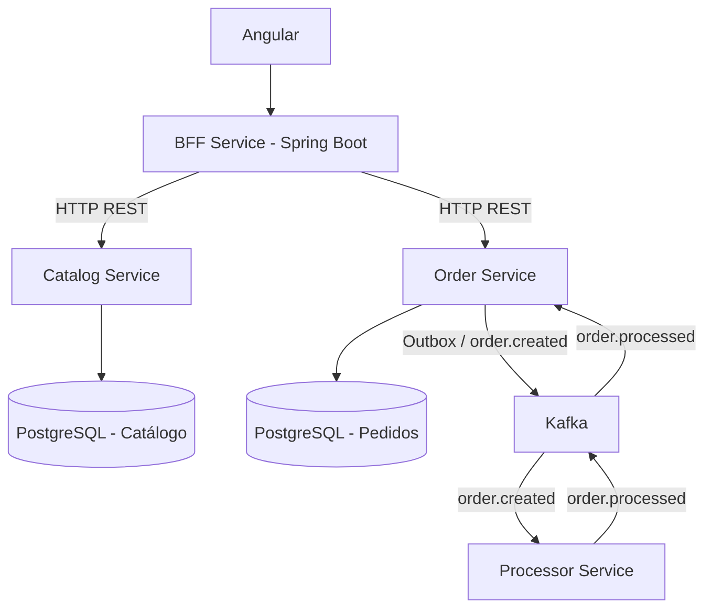

# OrderFlow — Projeto de Referência de Arquitetura

**Stack:** Java · Spring Boot · Angular · PostgreSQL · Kafka · Redis · Docker · Kubernetes · Azure

## Objetivo

Construir uma aplicação pequena, clássica e reutilizável como referência para projetos futuros. O foco não é a complexidade do negócio, mas aprender backend, BFF, microserviços, comunicação síncrona e assíncrona, persistência, segurança, resiliência, observabilidade e infraestrutura.

O **OrderFlow** é um sistema simplificado de gerenciamento de pedidos (mini OMS), **não** um e-commerce completo.

## 1. Funcionalidades mínimas

1. **Produtos:** cadastrar e consultar produtos com nome e preço.
2. **Pedidos:** criar um pedido com um ou mais produtos.
3. **Processamento:** simular o processamento de pedidos por meio de eventos Kafka.
4. **Consulta:** acompanhar o status de um pedido.

Não haverá pagamento real, controle de estoque, entrega, impostos, cupons nem regras complexas.

### Estados do pedido

```text
PENDING → PROCESSING → COMPLETED
```

O processamento é simulado, sem integrações externas.

## 2. Arquitetura de referência



Este é um diagrama lógico simplificado. O Redis será adicionado como cache de catálogo; segurança e observabilidade serão incorporadas nas etapas seguintes.

### Responsabilidades

| Serviço | Responsabilidade |
|---|---|
| `catalog-service` | CRUD de produtos |
| `order-service` | Criar pedidos, armazenar status e consumir resultados de processamento |
| `processor-service` | Consumir eventos e simular o processamento |
| `bff-service` | Adaptar APIs para o Angular e agregar informações |
| `frontend` | Interface simples para operar a aplicação |

Cada serviço de negócio deve ter sua própria base lógica no PostgreSQL, sem acesso direto às tabelas de outros serviços.

## 3. Tecnologias e aplicação prática

| Tecnologia | Aplicação |
|---|---|
| Java + Spring Boot | APIs REST, regras e consumers |
| Spring Data JPA | Persistência |
| Flyway | Versionamento de esquema de banco |
| PostgreSQL | Dados de produtos e pedidos |
| Kafka | Comunicação assíncrona |
| Redis | Cache de catálogo |
| Spring Security + JWT | Autenticação e autorização |
| Resilience4j | Timeouts, retries e circuit breaker |
| Docker Compose | Ambiente local |
| Testcontainers | Testes de integração |
| OpenTelemetry | Tracing distribuído |
| Prometheus + Grafana | Métricas e dashboards |
| Kubernetes | Orquestração |
| Azure | Hospedagem e serviços gerenciados |
| GitHub Actions | CI/CD |

## 4. Plano de desenvolvimento incremental

Cada versão será um exemplo funcional, consultável por uma tag Git.

### Versão 01 — Backend clássico

**Conceitos:** Spring Boot, REST, JPA, PostgreSQL, Flyway e testes.

- Criar `catalog-service` e `order-service`.
- Implementar APIs REST de produtos e pedidos.
- Persistir dados em bancos lógicos separados.
- Versionar o banco com Flyway.
- Criar testes de unidade e integração com Testcontainers.

**Entrega:** serviços com APIs REST e persistência funcionando localmente.

**Tag sugerida:** `v1-rest`.

### Versão 02 — BFF e comunicação síncrona

**Conceitos:** BFF, HTTP REST, DTOs, integração entre serviços e tratamento de falhas.

- Criar `bff-service` em Spring Boot.
- Expor endpoints específicos para a interface Angular.
- Consultar catálogo e pedidos via HTTP.
- Implementar timeouts e tratamento padronizado de erros.
- Criar um frontend Angular mínimo.

**Entrega:** frontend consumindo os serviços exclusivamente pelo BFF.

**Tag sugerida:** `v2-bff`.

### Versão 03 — Kafka e processamento assíncrono

**Conceitos:** eventos, producers, consumers, retry, DLQ, idempotência e Outbox.

- Subir Kafka via Docker Compose.
- Registrar `order.created` em Outbox no `order-service`.
- Publicar o evento no Kafka.
- Criar `processor-service` para consumir e simular o processamento.
- Publicar `order.processed`.
- Fazer `order-service` consumir o resultado e atualizar o status.
- Testar mensagens duplicadas, falhas e indisponibilidade do consumer.

**Entrega:** pedido processado de modo assíncrono e confiável.

**Tag sugerida:** `v3-kafka`.

### Versão 04 — Cache e segurança

**Conceitos:** Redis, TTL, invalidação, JWT e Spring Security.

- Implementar cache de catálogo no Redis.
- Definir TTL e estratégia de invalidação.
- Adicionar autenticação com JWT e autorização por papel.
- Exercitar falhas e aplicar mecanismos de resiliência com Resilience4j onde fizer sentido.

**Entrega:** APIs protegidas e consultas de catálogo com cache.

### Versão 05 — Observabilidade

**Conceitos:** logs estruturados, métricas e tracing distribuído.

- Instrumentar os serviços com OpenTelemetry.
- Coletar métricas com Prometheus.
- Criar dashboards no Grafana.
- Configurar tracing distribuído.
- Simular falhas e acompanhar uma requisição de ponta a ponta.

**Entrega:** ambiente monitorável com rastreabilidade entre serviços.

### Versão 06 — Containers e cloud

**Conceitos:** Docker, Kubernetes, CI/CD e Azure.

- Criar Dockerfiles e Compose completo.
- Criar pipeline com GitHub Actions para build, testes e imagens.
- Implantar inicialmente em Kubernetes local.
- Publicar imagens no Azure Container Registry.
- Avaliar deploy no Azure Kubernetes Service (AKS).
- Configurar secrets, probes e escalabilidade básica.

**Entrega:** aplicação reproduzível, implantável e documentada.

> **Custo:** serviços gerenciados e AKS podem gerar cobrança. Priorizar Docker Compose e Kubernetes local antes de provisionar recursos pagos.

## 5. Estrutura do repositório

```text
orderflow/
├── frontend/
│   └── orderflow-web/
├── services/
│   ├── bff-service/
│   ├── catalog-service/
│   ├── order-service/
│   └── processor-service/
├── infrastructure/
│   ├── docker/
│   ├── kafka/
│   ├── kubernetes/
│   └── terraform/
├── docs/
│   ├── architecture/
│   ├── adr/
│   └── tutorials/
├── .github/
│   └── workflows/
└── compose.yaml
```

Cada serviço Spring Boot terá seu próprio `pom.xml`, migrations, testes e configurações. O repositório será um monorepo, mas os serviços continuarão independentes em execução e deploy.

Para ser uma base reutilizável, o projeto também terá ADRs (registros de decisões arquiteturais), exemplos de configuração, health checks, tratamento padronizado de erros, testes e templates para novos serviços.

## 6. Fluxo principal de ponta a ponta

1. **Criar pedido:** Angular envia requisição ao BFF, que chama o Order Service. O pedido é salvo como `PENDING`.
2. **Publicar evento:** Order Service registra um evento na tabela Outbox; um publicador envia `order.created` ao Kafka.
3. **Processar:** Processor Service consome o evento, simula o processamento e publica `order.processed`. Durante o processamento, o status pode passar a `PROCESSING`.
4. **Atualizar status:** Order Service consome o resultado e altera o pedido para `COMPLETED`.

O fluxo pode ser reaproveitado para processamento de documentos, geração de relatórios, importações e outras tarefas assíncronas.

## 7. Critérios para tornar o projeto uma referência

Para **cada tecnologia adicionada**, incluir:

- Um exemplo funcional.
- Um teste automatizado.
- Uma explicação de quando utilizá-la e quando evitá-la.
- Documentação dos trade-offs e das decisões arquiteturais.

**Exemplo com Kafka:** não basta publicar e consumir mensagens. Também testar o que ocorre quando um consumer está indisponível, recebe a mesma mensagem duas vezes ou falha no meio do processamento.

O objetivo é aprender sistemas corporativos reais, e não apenas criar serviços que trocam JSON.

### Estratégia de escopo

- Manter o Angular propositalmente simples.
- Concentrar aproximadamente 80% do esforço em backend, arquitetura e infraestrutura.
- Começar com dois serviços de negócio; adicionar os demais conforme houver necessidade didática.
- Evitar complexidade de domínio que não contribua para o aprendizado.

## 8. Primeiro passo recomendado

Começar pela **Versão 01**, com `catalog-service` e `order-service` usando Spring Boot, PostgreSQL, Flyway e Testcontainers.

Depois evoluir a **mesma aplicação**, sem recomeçar a cada tecnologia.

### Alternativa ainda menor

Se o domínio de pedidos parecer grande, seria possível usar um sistema de tarefas (`TaskFlow`). Entretanto, o OrderFlow é mais apropriado para demonstrar comunicação entre serviços sem regras de negócio excessivamente complexas.
